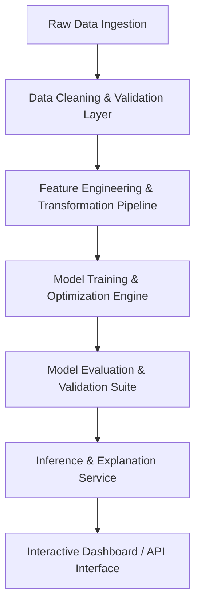

# System Architecture & Technical Design

## 1. High-Level System Overview
This document outlines the overarching architecture of the **Employee Performance Predictor using Data Analytics**. The system transforms raw workforce and HR metrics into actionable predictive intelligence regarding employee performance ratings and growth trajectories.

---

## 2. Component Hierarchy
1. **Data Ingestion & Invariant Checks**: Schema validation, boundary checks, missing value identification.
2. **Preprocessing & Feature Engineering Pipeline**: Encoding categorical variables, numeric scaling, interaction features, performance indexes.
3. **Model Core**: Supervised machine learning algorithms (e.g., Random Forest, XGBoost, LightGBM, Gradient Boosting) with hyperparameter search.
4. **Model Explainability & Insights**: Feature importances, SHAP values, and key drivers of high/low performance.
5. **Validation & Monitoring**: Stratified cross-validation, bias/fairness checks, drift awareness.

---

## 3. Technology Stack (To be confirmed upon execution)
- **Language**: Python 3.10+
- **Data Manipulation**: Pandas, NumPy
- **Machine Learning & Modeling**: Scikit-Learn, XGBoost, LightGBM
- **Explainability**: SHAP
- **Visualization & UI**: Matplotlib, Seaborn, Streamlit (or modern web UI)
- **Testing**: Pytest / Assertive unit tests

*(This document will be updated with exact architectural details as components are implemented).*
