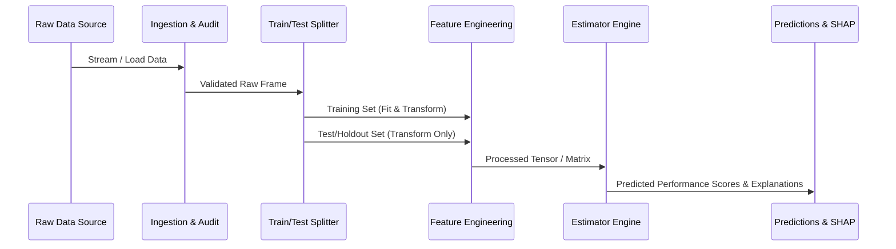

# Data Flow & Lifecycle Specification

## 1. End-to-End Data Pipeline

The data flows through distinct, deterministic phases to prevent data leakage and ensure reproducible training and inference.

---

## 2. Pipeline Stages

### Stage 1: Data Ingestion & Integrity Verification
- Ingest raw dataset files (CSV, Excel, DB, etc.).
- Validate column naming conventions, null distributions, data types, and row invariants.

### Stage 2: Partitioning & Leakage Prevention
- Establish strict training/validation/testing splits (stratified by target performance rating) prior to any global statistics computation (e.g., mean imputation, target encoding, standard scaling).

### Stage 3: Transformation & Feature Synthesis
- Categorical encoding (Target/One-Hot/Ordinal).
- Handling outliers and missing data imputation.
- Domain feature generation (tenure ratios, project completion efficiency, training impact index).

### Stage 4: Inference Flow
- Incoming record validation $\rightarrow$ Transformation application $\rightarrow$ Predictor execution $\rightarrow$ Explanatory contribution breakdown.

*(Detailed transformation parameters and schemas will be updated once the dataset is introduced).*
